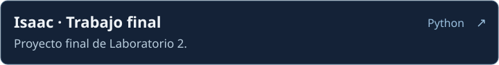

  

Estudiante de **Redes Informáticas en la Universidad Nacional de San Martín**, Buenos Aires, Argentina.

En este perfil comparto proyectos académicos y trabajos de programación en Python, Assembly 8086 y Wollok.

&nbsp; 

### Proyectos destacados

### Áreas de formación

Redes informáticas · Programación · Desarrollo de proyectos académicos
